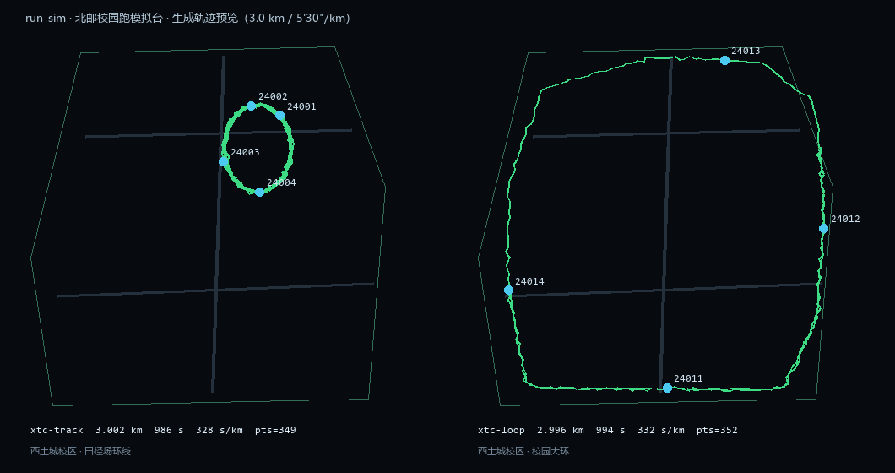

# run-sim · 北邮校园跑（网页版）

> 仿「校园跑」小程序形态的**本地 Web App**：跑步页（配速/用时/公里数 + 打卡点）→ 生成轨迹 → 本地预检 →
> 存档/导出 → 平台记录同步。全程只在本机，不登录平台、不上传，除非你显式配置 token 做**只读同步**。
>
> 页面结构对照小程序跑步页（[BUPT 智慧体育](https://guide.byrdocs.org/) 那套：大号配速/用时/公里数 +
> 打卡点列表 + 自由打卡模式 + 长按暂停），并补上网页端才有的能力：参数面板、预检规则、记录库、同步。
>
> 许可证跟随本仓库 **LRL-1.0**（仅供学习 · 不可牟利 · 再发布须署名引用原始仓库）。

---

## v0.2 做了什么

| 模块 | 说明 |
|---|---|
| **App 形态页面** | 单列 520px、底部 4 tab（跑步 / 记录 / 同步 / 我的），移动优先，桌面居中 |
| **跑步页** | 跑区胶囊切换 → 地图 → 三大指标（配速/用时/公里数）→ 打卡点列表（已打卡/偏差米数）→ 生成参数（折叠）→ 预检 |
| **回放** | 生成后自动回放，指标实时跟着轨迹走；可暂停/继续/适应窗口 |
| **记录页** | 有效里程 / 有效次数 / 本周里程 + 学期进度条 + 全部/有效/无效/仅本地筛选 |
| **同步页** | 平台账号（学号/uid/token/api_host/出口代理）+ 数据源切换 + 同步日志 + 平台/本地/已对齐统计 |
| **我的** | 档案（姓名/性别/学期目标）、判定策略、导出（GPX/JSON/协议形态）、提交预演 |
| **数据同步** | `auto` / `lepao`（真实只读拉取）/ `demo`（合成演示）三个适配器，按 `record_id` 去重合并 |

生成引擎与预检规则未变（v0.1 的 7 条规则、两轮校准、起点相位选择都在）。

---

## 快速开始

```bash
py -3 run-sim/server.py --port 8771
# 或双击 run-sim/启动模拟器.bat
# 浏览器打开 http://127.0.0.1:8771（手机同局域网也行，但默认只听 127.0.0.1）
```

零第三方依赖。自检（不启服务）：

```bash
py -3 run-sim/selftest.py -v      # 生成 + 预检 + 导出 + 同步（demo / 假 client）
```



---

## 数据同步怎么工作

```
平台记录  ←── lepao.v3api.V3Client ──┐
（只读）      beforeRunV260 → getTermRunRecord(分页)
              → recordDetailV270（最近 5 条拿权威状态）
                                     ├─→ sim/sync.py 归一化 → data/platform.json
本地记录  ←── sim/store.py ──────────┘        ↓
                                     sim/sync.dashboard() → 页面「记录」
```

| 适配器 | 是否需要 token | 行为 |
|---|---|---|
| `auto`（默认） | 有就用 | 有 token 走真实拉取，没有回落演示 |
| `lepao` | 需要 | 只读拉平台记录；token 失效返回 101 并提示重抓 |
| `demo` | 不需要 | 合成 21 天内的记录，用来验界面与对齐逻辑（界面标注「演示」） |

**配置真实同步的三步**（同步页 → 平台账号）：

1. `学号` / `uid`：抓号后自动回填，也可手填；
2. `token`：抓号拿到的那串（**一次有效**，提交/同步完即失效）；
3. `api_host` + `出口代理`：默认 `api2.lptiyu.com` + `127.0.0.1:8081`（mitm）。

> token 与登录出口绑定：不走同一条 mitm 链，平台会返回 101。抓号本身仍用仓库根目录的
> `py -3 cli.py capture --member <名字>`，本页面只负责「用 token 拉数据」。

**判定与对齐**

- 有效：`record_status ∈ {0,1}` 且 `record_failed_reason` 不含否定词（沿用 `lepao/pipeline.py` 的口径）；
- 对齐：平台记录与本地记录在 `start_time ±180s` 且 `distance ±0.08km` 内视为同一次，记录页显示「已同步」；
- 未对齐的本地记录标「仅本地」——说明这条还没提交到平台。

---

## 目录结构

```
run-sim/
├── server.py             HTTP 服务（标准库）
├── selftest.py           自检：生成/预检/导出/同步
├── 启动模拟器.bat        双击入口
├── config/
│   └── bupt_routes.json  校区 / 跑区几何 / 打卡点 / 策略
├── sim/
│   ├── geo.py            地理原语
│   ├── catalog.py        配置解释（几何环、打卡点、最小覆盖里程）
│   ├── engine.py         轨迹引擎注册表：math / template
│   ├── validate.py       预检规则注册表（7 条）
│   ├── exporters.py      导出器：gpx / json / protocol
│   ├── submit.py         提交适配器（offline 预演）
│   ├── sync.py           同步适配器：auto / lepao / demo
│   ├── credentials.py    本机账号档案（学号/token/出口）
│   └── store.py          本地记录库
├── web/
│   ├── index.html        4 tab 单页
│   ├── app.js            地图 canvas + 视图 + 交互
│   └── style.css         深色主题，无外链资源
├── docs/preview-map.png  轨迹预览（README 用）
└── data/                 运行时（已 gitignore）
    ├── records.json / tracks/    本地记录
    ├── platform.json             同步下来的平台记录
    ├── credentials.json          学号 / token / 出口（只在本机）
    └── profile.json              档案
```

---

## 接口

| 方法 | 路径 | 用途 |
|---|---|---|
| GET | `/api/bootstrap` | 目录 + 策略 + 引擎/导出器/同步器 + 仪表盘 + 账号（脱敏） |
| GET | `/api/dashboard` | 记录合并视图 + 统计（有效里程/次数/本周）+ 同步状态 |
| POST | `/api/generate` | 生成轨迹（距离/配速/时间/种子/引擎）→ 指标 + 打卡点 + 预检 |
| POST | `/api/sync` | `{adapter}` → 拉平台记录、去重合并、回仪表盘 |
| GET | `/api/sync/status` | 上次同步时间/来源/条数 |
| GET/POST | `/api/credentials` | 读（脱敏）/存账号；`POST /api/credentials/clear-token` 清 token |
| GET/POST | `/api/records` | 列表 / 存档 |
| GET/DELETE | `/api/records/<id>` | 单条 / 删除 |
| GET | `/api/records/<id>/export/<fmt>` | `gpx` / `json` / `protocol` |
| POST | `/api/verify` · `/api/submit` | 重跑预检 / 离线提交预演 |
| GET/POST | `/api/profile` · `/api/policy` | 档案与策略 |

---

## 扩展点

| 想加什么 | 改哪里 |
|---|---|
| 新同步源（如学校自建接口、H5 面） | `sim/sync.py` → `register(...)`，前端数据源自动出现 |
| 新生成引擎 | `sim/engine.py` → `register(...)` |
| 新预检规则 | `sim/validate.py` → `RULES` 追加 |
| 新导出格式 | `sim/exporters.py` → `register(...)` |
| 真机提交 | `sim/submit.py` → `register_adapter("lepao", ...)`，把参数交给 `lepao.pipeline.Pipeline` |
| 换/加跑区 | 只改 `config/bupt_routes.json` |
| 换存储（SQLite/远端） | `sim/store.py` 对外函数 |

---

## 已知边界

1. **演示数据是合成的**：`demo` 适配器造的记录不来自平台，界面会标「演示」，别当成真实成绩。
2. **真实同步要 token**：且 token 一次有效、与出口绑定；没有 token 时 `lepao` 适配器会明确报错而不是假装成功。
3. **坐标仍是 fixture**：`config/bupt_routes.json` 里是演示坐标，与平台下发的真实跑区不同；真实上传要走服务端 `point_list`。
4. **v0.2 仍不上传**：`/api/submit` 只做离线预演，真机提交需要自备合法账号并按 `sim/submit.py` 的接口接入。
5. 服务默认只听 `127.0.0.1`；手机访问请自己权衡（`--host 0.0.0.0` 后同网段都能点同步/保存）。

---

## 版本

- **v0.2.0**：页面重做为 4 tab App 形态；新增数据同步（auto/lepao/demo）、账号档案、仪表盘与记录合并。
- **v0.1.0**：跑区/参数/生成/预检/地图/存档/导出；提交只做离线预演。
